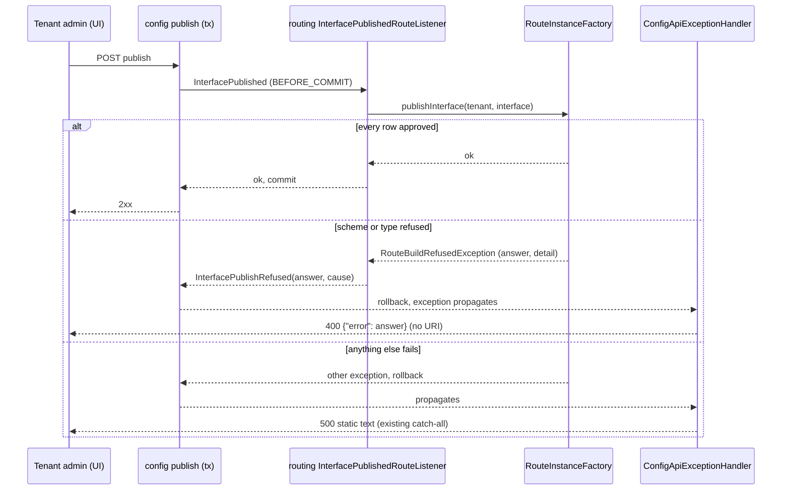

# ADR-017 - Publish refusal contract between routing and config

Conventions and grades as in [ADR-013](ADR-013-mapping-versions.md): **[Verified]** read in the
cited file this pass (main `f553783`), **[Inferred]** reasoned from cited sources, **[TBD]** needs a
later step. Not a cross-project decision.

## Context

Review finding C2 (Kavita, T106 review of `08fe511`/`c13c2b7`, Medium, Consider): the F15 fix made
routing's refusal type a subclass of the configuration module's HTTP error type, so a refused
publish answers 400 instead of 500.

- `RouteBuildRefusedException` imports and extends `io.integrationplatform.config.application.ConfigApiException`
  (`platform-routing/src/main/java/io/integrationplatform/routing/templates/RouteBuildRefusedException.java:3`, `:14`).
  It is the only routing main file that imports `config.application`. [Verified]
- **Publish path.** Config publishes the `InterfacePublished` event (public package `config.flow.api`,
  `platform-config/src/main/java/io/integrationplatform/config/flow/api/InterfacePublished.java:16`).
  Routing's `InterfacePublishedRouteListener` runs at `BEFORE_COMMIT` (`InterfacePublishedRouteListener.java:30-35`)
  and calls `RouteInstanceFactory.publishInterface` (`RouteInstanceFactory.java:78-80`). That call
  throws from `approvedTemplate` (`:118-127`). The exception reaches
  `ConfigApiExceptionHandler.refusal` (`platform-config/.../config/adapter/in/ConfigApiExceptionHandler.java:48-54`),
  which answers with `httpStatus()` and `body()`. [Verified]
- **Send path.** Stage 2 catches the same type from `ensure()` (`DueDeliverySend.java:109-111`) and
  dead-letters the delivery PERMANENT (`:145-149`). The type's 409 (route-id clash,
  `RouteInstanceFactory.java:102`) is only thrown from `ensure()`, and `ensure()` has one caller,
  `DueDeliverySend.java:109`. So no HTTP client ever sees that status. [Verified]
- **Direction.** `platform-routing` depends on `platform-config` (`platform-routing/pom.xml:37-40`).
  `platform-config` has 0 imports of `io.integrationplatform.routing` in main (grep, `f553783`).
  If config's handler named a routing type, the Maven graph would get a cycle. [Verified]
- **Rules on the books.** ADR-001 rule 5 says a module's public surface is its base package plus
  `port` and `event` sub-packages ([ADR-001](ADR-001-modular-monolith.md)). ADR-015 Decision 2 says
  "routing -> config api only, never config internals" and leaves the enforcing rule as **[TBD]**,
  to be written in the E10 seam. The only boundary rule today, `ModuleInternalsRule`, bans packages
  named `.internal.` only (`arch-test/.../ModuleInternalsRule.java:30-34`, `:56-58`). Config has no
  package named `internal` on this path, so the rule cannot see C2. That is why it passed. [Verified]
- **What routing imports from config today** (import lines in `platform-routing/src/main`):
  `credential.api` 14, `destination` 8 (the `DestinationGuard` ADR-015 names as public),
  `flow.api` 1, `flow.application` 1 (`Stage1FanOut.java:3`, `FlowBundle`, this ADR does not
  change it), `application` 1 (C2). [Verified]
- `ConfigApiException` has `protected` constructors so that config's own refusals can subclass it
  (`ConfigApiException.java:21`, `:28`). 25 config main files use it. [Verified]

## Options

| | Option | Complexity | Risk | Cost | Reversibility |
|---|---|---|---|---|---|
| A | **Accept** routing -> `config.application` and record it | 0 code | Stage 2 (data plane) catches the config HTTP API's error type. A change to `ConfigApiException` (status rules, body shape) reaches routing. Breaks ADR-001 rule 5 and ADR-015 D2, and is the precedent for the next import | 1 ADR line | One revert |
| B1 | **Config handler maps routing's type** | - | **Not possible**: config -> routing would make a Maven cycle | - | - |
| B2 | **Config owns a publish-refusal type in its public `flow.api` package.** Routing's listener translates its own refusal into it, and config's handler maps it to 400 | 1 new type (~20 lines), 1 handler method, 1 try/catch in the listener, 3 tests re-pointed, 1 arch rule + planted fixture | Low: same 400 body, same text, same rollback | ~1 lane-day | One revert |
| C | **Shared type in `platform-domain`** (a refusal carrying a status) | 1 type + all of B2's wiring | Puts an API answer (an HTTP status) into the shared kernel that every module sees. `architecture.md:47` keeps the domain to ids, value types and the state register | ~1 lane-day | One revert, but every module then sees the type |
| D | **Move `ConfigApiException` to config's public surface** | 25 config files re-imported | Makes config's whole HTTP answer type public to every module. Stage 2 still catches an HTTP type | ~1 lane-day, wide diff | One revert, wide |

## Decision (Accepted, team, 2026-10-17)

**B2.** The publish event is config's public contract, so config also owns how a listener says no to
it. Routing keeps a refusal type of its own, with no HTTP status in it.

1. **New public type** `io.integrationplatform.config.flow.api.InterfacePublishRefused extends RuntimeException`,
   with `(String reason, Throwable cause)` and `reason()`. The javadoc and `flow/api/package-info.java`
   state the contract: a `BEFORE_COMMIT` listener of `InterfacePublished` refuses the publish by
   throwing it, and the publish rolls back. `reason` is safe to show a tenant admin; the thrower
   sanitises it (no URI, no userinfo, no credential, bounded length). [Inferred]
2. **Config maps it.** `ConfigApiExceptionHandler` gets `@ExceptionHandler(InterfacePublishRefused.class)`.
   It answers **400** with `ConfigApiException.body("error", reason())`, the same body shape as today.
   It does not log the reason above DEBUG and records no tenant denial (this is a validation refusal,
   not a cross-tenant attempt). [Inferred]
3. **Routing's type becomes routing's own.** `RouteBuildRefusedException extends RuntimeException`
   and imports nothing from config. It drops `httpStatus` and `body`. It keeps the `scheme(...)` and
   `targetType(...)` factories and their client-safe text, now exposed as `answer()`. `getMessage()`
   stays the log detail, including the stage 2 WARN line (`DueDeliverySend.java:146` at `6fc6975`);
   the dead-letter itself records no reason text (`recordFailure`, `:147-148`). The route-id clash gets its own factory with no status. [Inferred]
4. **The listener is the translation point.** `InterfacePublishedRouteListener.onInterfacePublished`
   catches `RouteBuildRefusedException` from `publishInterface` and throws
   `new InterfacePublishRefused(refused.answer(), refused)`. The factory stays pure routing. [Inferred]
5. **Stage 2 is unchanged in behaviour.** `DueDeliverySend` still catches `RouteBuildRefusedException`,
   which is now a routing type, and dead-letters PERMANENT. [Inferred]
6. **The boundary gets a rule.** This is the first enforced step of ADR-015 D2. A new ArchUnit rule
   in `arch-test` says classes in `io.integrationplatform.routing..` must not depend on any
   `io.integrationplatform.config..` package whose name contains `.application` or `.adapter`. It
   has **exactly one** named exception: `config.flow.application.FlowBundle`, which predates this
   ADR and is listed in Open. The rule has a planted fixture that fails it. Turning it into the full
   api-only allowlist stays with the E10 seam (ADR-015 D2). [Inferred; TBD for the allowlist]

### Flow, with failure paths

No external call is added or changed, so `## resilient-integration` does not apply. Everything
here runs in one process and one transaction.

### Gates (counts, checked at the lead gate on the C2 commit)

1. Import lines matching `import io.integrationplatform.config.application` in `platform-routing/src/main`: **0**.
2. `PublishRefusalAnswerTest`: **5 of 5** (the count at `6fc6975`, B22) pass with their assertions unchanged:
   400 on every test; names `'exec'` / `'FTP'`, no `SECRET_URI`, no `s3cret` (the two original tests); and the
   fixed texts `(not a URI scheme)` / `(not a target type)` with no `token@host`, `LONG_TYPE` or `X-Injected`
   (the three B22 tests). Every test now publishes **through the listener**, not by calling the factory directly.
3. New arch rule: **0** violations on production classes; **1** violation on the planted fixture;
   exception list size **1**.
4. Full gate: unit and `-Pcontainer` with **0** failures and **0** errors. The test count is at
   least the `c13c2b7` lead-gate counts (unit 670, container 1249) plus the new tests.

## Consequences

- Gains: routing no longer imports config's application layer. Stage 2 catches a routing type.
  Config decides the HTTP status of its own publish, and the boundary that ADR-015 D2 only described
  is now tested.
- The publish answer and the stage 2 WARN line both come from the same routing factory, so one
  sanitiser (Arjun's L1) covers both.
- **Gives up:** one more public type and one translation step. Ownership is split: config owns the
  status (400), routing owns the reason text. A second listener that needs a different status (409,
  422) cannot express it until `InterfacePublishRefused` grows a kind. The `FlowBundle` exception
  stays in the rule until it is moved.

## Revisit if

- A second publish listener needs a status other than 400. Then add a closed `kind` to
  `InterfacePublishRefused` and keep config owning the status mapping.
- Spring Modulith verification is adopted (ADR-001 rule 1). Then replace the rule in Decision 6
  with `@NamedInterface` checks.
- The E10 seam lands the full api-only allowlist (ADR-015 D2). Then fold Decision 6 into it.
